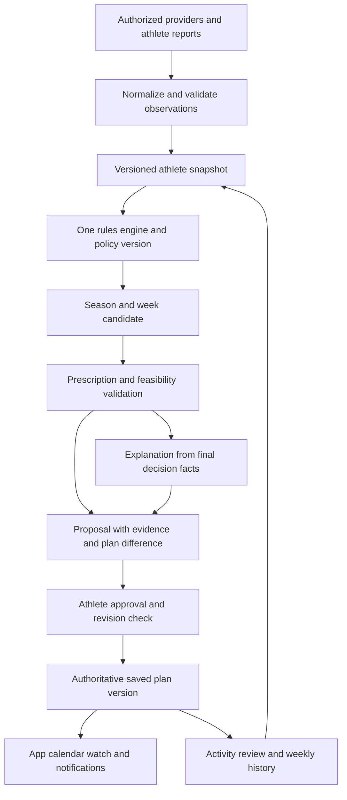

# IronZ brain review and acceptance specification

Draft for product and independent review, 9 November 2026. IronZ should understand the athlete, build a coherent long-term plan, coach day to day, review the week, and explain and remember decisions. The current app has useful components for each, but no unified, validated decision system. Establish one rules-based execution path and one authoritative saved prescription before enabling adaptive coaching.

The owner's existing coaching method supplies candidate principles and a private comparison case. Neither that method nor its current plan is ground truth. IronZ may produce a substantially different plan when the difference is justified by the same athlete facts, evidence and constraints. Both plans must be open to criticism.

This is an acceptance/design proposal, not an active training policy or authorization to release. No production behavior, clinical thresholds, provider connections or personal training plans change with this document.

## Review basis and authority

Main baseline: `681e68c`. Separately evaluated repairs: PR30 `9bb444b`, PR31 `907b4ee`, PR32 `7e7e0ac`; combined staging app `9316eb1`. Recovery work remains draft PR33 `d27a191`; Claude's calendar groundwork PR29 is now `382b169`. The adaptive-coach draft is PR17 `fa0367d`, internal version 0.3 despite the older PR title. These revisions describe a review snapshot, not a production claim.

Authority order for design: the owner's explicit decisions and [product direction](../PRODUCT_DIRECTION.md); approved training method in the [master spec](../../sources-of-truth/Engine%20Doc/PLAN_GENERATOR_MASTER_SPEC.md); [pipeline](../../sources-of-truth/RULE_ENGINE_SPEC.md) and [output schema](../../sources-of-truth/PLAN_SCHEMA.json); approved, versioned evidence-backed policy. The PR17 draft, this proposal and private reference examples require reconciliation before they become execution policy. [The source map](../../sources-of-truth/README.md) identifies live runtime data that cannot be deleted as documentation cleanup.

The private handover is a dated athlete report with training instructions mixed with history, assumptions and unresolved restrictions. Preserve those distinctions. It is not current clinical clearance, a complete export of the coaching project, or permission to publish personal data. No private numerical targets, locations, schedules or medical records belong in public fixtures.

## What exists and what is missing

| Responsibility | Current implementation and evidence | Gap and acceptance consequence |
|---|---|---|
| Understand the athlete | `AthleteClassifier.classify`, `TrainingZones`, onboarding and profile storage provide thresholds, goals, equipment and preferences. | No single versioned athlete snapshot. `_mapRacesToLegacyEvents` stamps intermediate and omits goal/lead-in fields; race-level override can defeat derived classification. Athlete choices must survive all adapters. |
| Activate the target engine | Target `_readProfile` supplies age/body defaults and reads profile fields while onboarding stores several inputs separately. `ArcBuilder` expects `raceType`/different enums; live events use `type`. Target classification does not carry `strengthRole`. | A normalized adapter is required before activation. Unknown facts cannot become invented body data; enum/role/threshold/days parity must be proved. Age/sex handling also differs between target classification and `TrainingZones`; reconcile only evidence-supported use, not automatic demographic adjustments. |
| Reconcile target policy | `PlanValidator.checkVolumeIncreaseCap` and `_buildConstraints` permit 15 percent for intermediate athletes while master sections 0/2g specify 10 percent. Independent synthetic target replay retained 100-to-115-minute weeks without a flag. | Target activation blocker, distinct from the live scheduling/date fixes. Choose and evidence-review one sport/phase policy; do not silently preserve whichever constant the replacement happens to use. |
| Represent recovery | `deriveRecoveryState` reads camelCase check-in fields and defaults missing/invalid data to good; `recordWeeklyCheckIn` writes snake_case fields. | Unknown can become false reassurance. One check-in contract, source timestamps, validity and explicit unknown are required. |
| Generate the long-term plan | Live `planner.js:generateTrainingPlan`; target `PlanGenerator.generate`; legacy module-driven `generatePlanFromModules` coexist. | One public generation contract must select one engine. Console-only replacement code is not production parity. No hidden regeneration from a second engine. |
| Honor constraints | Live distribution/constraint passes and the separate availability repair cover part of the problem. | Every entry point and post-processing pass must obey the same day, sport, facility, duration, injury and race-priority constraints. Infeasibility must be explained, not silently patched by adding sessions. |
| Apply recovery restrictions | PR29 adds calendar ranges/display adjustments; PR33 proposes prescription-level holds and source reconciliation. | Neither is a certified end-to-end return policy. Calendar labels, saved steps, totals and exports must agree; time elapsed cannot grant clearance. |
| Adapt actual workouts | `adaptive-coach.js:adjustPlanIntensity` steps through easy/moderate/hard/long labels in `workoutSchedule`. | Duration, structure and intent are conflated; actual intervals can remain unchanged. Adaptations must replace the real prescription and revalidate all constraints. Race-plan sessions must not be omitted because they live in another store. |
| Review completed work | Strava ingestion, workout logs, weekly check-ins and stats exist. | No demonstrated unified prescription-version-to-activity grading loop. Missing uploads, duplicate activities, unit mismatches and ambiguous matches need explicit handling before judgment. |
| Coach from trends | PR17 describes personal baselines, daily briefs, recurring patterns and weekly approval. | This daily/weekly loop is a draft, not implemented. Readiness evidence is not a diagnosis or an automatic permission to increase load. |
| Remember and synchronize | DB layer syncs several browser keys; wizard checked-save repair protects its batch. Target `storePlan` still has its own cache save path. | No common revision/conflict contract across all writers. Old devices, late jobs and duplicate deliveries must not overwrite an approved plan. |
| Explain and publish | Rationale builder, Ask IronZ and notification/export infrastructure supply pieces. | Explanation must describe the final validated prescription, including changes made by validators. AI text, calendar and watch delivery must never become separate authorities. Provider paths remain unverified. |
| Reproduce the method | Master spec, hard-coded constants and runtime philosophy modules coexist. `PHILOSOPHY_VERSION` is 1.4 in target code while the source map identifies master v2.5. | A label alone cannot prove method parity. Pin a reviewed policy manifest to code, evidence and tests; keep old runtime modules until all consumers are migrated. |

### Priority before trusting the brain

| Priority | Gap | Scope |
|---|---|---|
| Critical before affected athlete use | Restrictions can be display-only; label changes can leave hard prescriptions; unknown recovery can be treated as good. | Existing paths and held drafts; require actual prescription and unknown-state gates. |
| Critical before any plan mutation | Multiple stores/writers lack one revision/permission/history contract; a stale plan can overwrite a reviewed one. | Whole-plan persistence and cross-device behavior, beyond the wizard's repaired save. |
| Major before target activation | Goal/experience/strength-role losses, target profile defaults and race enum mismatches. | Adapter and target engine. Switching entry points alone is insufficient. |
| Major before target activation | Target progression constants disagree with the approved master; demographics and constraints differ by path. | Reconcile policy applicability and exact tests before enabling replacement. |
| Major before adaptive coaching | No proven executed-prescription grading, coherent trend confidence or weekly approval loop. | New review capabilities; do not describe draft functionality as shipped. |
| Major before method claims | Runtime module drift, stale philosophy version labels and unreviewed numerical rules. | Evidence manifest, dependency migration and qualified review; no blanket science or safety claim. |

### Five decisions to preserve from the reference method

1. **Athlete context persists.** Goals, reported restrictions, training response, preferences and recurring logistical limits influence future recommendations; every fact has a source and an effective date.
2. **Sessions have a purpose and a ceiling.** Prescribe one current workout, with clear targets, caps, structured steps and rationale. Keep repeatable benchmarks while varying supporting work deliberately.
3. **Recovery and feedback influence the plan.** Compare trends with the athlete's own history and grade against what was actually prescribed. Account for data quality and ask for information the app cannot infer reliably.
4. **The week remains coherent.** An adjustment considers nearby key sessions, accumulated work, recovery, race priorities and supporting strength. Missed sessions do not create automatic catch-up volume.
5. **Feedback teaches and records decisions.** Daily guidance and weekly reviews explain the recommendation and retain the evidence, approvals and resulting plan versions.

Personal tone, fixed biometric cutoffs, calendar placements, body-composition goals, target paces and sport priorities are athlete-specific inputs. They must not become defaults for everyone. A personal seasonal plan is not evidence that its volume or intensity suits another athlete.

## Policy conflicts to resolve before implementation

| Conflict | Proposed resolution for acceptance |
|---|---|
| PR17 defaults small-change automation on and retains automatic Rest changes when adjustment permission is off; recorded product direction starts proposal-first. | V1 decisions are proposals; permission to send a brief is separate from permission to change a plan. Restrictions make a workout ineligible regardless of approval, without secretly approving a replacement. Future opt-in automation needs its own scope, tested limits and revocation semantics. |
| Missing wellness versus green readiness | Distinguish known restriction, concerning report, insufficient data, usable trend and no detected trigger. Lack of a trigger with insufficient data is not green recovery. Missing wellness alone need not erase a known, otherwise eligible plan, but cannot justify an increase. |
| One decisive prescription versus athlete choice under uncertainty | Give one recommended proposal with evidence and uncertainty. The athlete can approve, decline or correct facts. If unanswered, retain the last approved eligible prescription; never retain a prescription made ineligible by a restriction. |
| Maximum quality work differs by engine, experience and phase | Define quality sessions, quality days and cross-sport hard exposure separately. Agree a phase/athlete policy with explicit applicability. Two hard sessions on one day count as two sessions and one hard day. No blanket advanced-athlete exception without reviewed rationale. |
| Deload size, run progression and long-run share differ | Record reference period, sport, denominator, units, recovery-week handling and applicability. Do not pick whichever constant makes a failing example pass. A percentage ceiling is a configurable policy, not proof of safety. |
| Strength support versus equal-priority hybrid training | Persist athlete-selected strength role and goals. Secondary-event preparation substitutes within the agreed load budget; it is not automatically extra work. Unsupported combinations return a feasibility proposal. |
| Nutrition and hydration are central in the reference method | Make support optional and privacy-aware; targets follow reviewed policy, current session demands and explicit athlete constraints. Do not infer a diagnosis or automatic calorie deficit from weight or logging gaps. |
| Generic return template versus specific reported restrictions | Apply discipline-specific restrictions until explicitly updated. Cleared easy training, unrestricted training and verified medical instruction are different records. No generic rest week or ramp formula establishes readiness. |

## One engine and one plan authority

Use the existing Rule Engine as the consolidation target after closing its gaps. Do not build a fourth planner. The following names describe responsibilities, not a requirement for a particular framework or service layout.

The same rule package evaluates initial generation, race edits, direct regeneration, imported plans, today's adjustment and next-week review. The browser may preview with the same package, but authoritative commits validate ownership, permissions, expected revision and idempotency server-side. A service boundary can be introduced after contract tests; no backend migration is authorized by this proposal.

An imported plan remains an immutable source version with provenance. Normalize and assess it before offering adoption. Importing a workout must not execute instructions embedded in free text, bypass validation, change user settings or authorize exports.

### Required records and execution contract

| Record | Minimum information |
|---|---|
| Athlete snapshot | Athlete ID, snapshot revision, effective/as-of time, timezone, goal priorities, sport-specific capacity/history, goals/preferences, availability/facilities, units, restrictions, source observations and missing/uncertain fields. Never infer every sport's training tolerance from the strongest sport. |
| Observation | Source/provider ID, metric/unit, event time, received time, valid interval, quality, consent scope and correction lineage. Track planned, completed, reported and inferred values separately. |
| Plan and prescription | Plan/version/revision, policy and engine versions, input snapshot ID, generation as-of time and variation seed; stable session ID; local date/timezone; discipline, purpose, complete steps, targets/caps, duration totals and key-session status. Unknown quantities stay unknown. |
| Decision or proposal | Before/after prescription IDs, reason codes, supporting observation IDs, applicable rule/evidence IDs, uncertainty, validation results, affected weeks, permissions, expiry and status. |
| Commit and delivery | Expected current revision, authenticated owner, idempotency key, whole-plan result and audit event. External delivery tracks destination/version/status separately; a failed export never rolls back or duplicates the approved app prescription. An old watch/calendar copy made ineligible by a new restriction is visibly stale and must not be followed; mark removal/update pending, explain the mismatch, and do not claim remote recall succeeded. |
| Review | Matched activity and executed prescription version, actual versus prescribed metrics, coverage/missingness, athlete corrections, weekly summary revision, reviewer findings and next-week proposal ID. Corrections append a superseding review rather than rewriting prior decisions invisibly. |

For identical snapshot, policy, as-of time and seed, decisions are reproducible. Text wording may vary but cannot alter targets. Inputs that change units, source ordering, duplicate observations or device arrival time without changing the accepted facts must not change the plan.

Conflicting restrictions produce a visible hold/clarification, not a permissive union. Validation runs again after every transformation, including workout selection and schedule placement. If a rule cannot be satisfied, retain the previous immutable plan/history and return a structured infeasibility result. Retention does not authorize executing/exporting old sessions made ineligible by a new restriction; those receive a visible hold. If a reported restriction cannot be saved, show an unsaved restriction warning and immediate visible local hold, block locally controllable starts/exports, retry durable persistence, and disclose that other devices cannot be guaranteed updated until acknowledgement. Never say the old plan remains safe or the restriction is saved. For ordinary generation failure, never show generation success for accidental empty output. An intentional paused plan is valid only when visibly labeled and separately tested.

## Acceptance requirements for the five responsibilities

Each requirement is a release gate for its capability. The [scenario catalog](ACCEPTANCE_CASES.json) lists planned cases; it is not evidence that those tests have run.

| Gate | Required observable result | Scenarios |
|---|---|---|
| Understand the athlete | Correct units/sport levels, goal and strength-role preservation, explicit unknowns, fresh observations and discipline-specific restrictions; no silent intermediate or recovered fallback. | A01–A06 |
| Build the long-term plan | Eligible schedule; phase/race coherence; progression tied to actual tolerated history or an explicit provisional start; preserved deload/taper; purposeful variety; infeasibility instead of invented capacity. | A07–A13 |
| Coach day to day | Match the executed prescription version; qualify missing/poor data; create real validated changes; proposal-first permission; respect holds and stale approvals. | A14–A20 |
| Review the week | Reconcile imports and manual reports, compare by sport and purpose, preserve missingness, explain trends, draft next week without silent commitment or catch-up. | A21–A24 |
| Explain and remember | Final-plan-consistent rationale, durable provenance/history, safe conflicts/failures, independent notification consent/timezone behavior, accurate export state and data isolation. | A25–A30 |

No averaging can hide a hard failure. A clinician restriction violation, unauthorized plan change, corrupted unit, invented clearance, cross-user leak or lost approved plan blocks adoption regardless of similarity to the reference plan.

A minimum supported cohort must also cover novice running, experienced cycling, multisport with unequal sport capacity, hybrid with athlete-selected strength priority, sparse wellness data, constrained availability and a restricted-return case. The owner's reference case is one member of the cohort. Broadening to unsupported sports, populations or medical scenarios requires new acceptance evidence.

### Science and policy evidence register

Every active training rule needs a rule ID, claim, applicable population/context, primary source, limitations, policy/default status, implementation owner, revision and acceptance cases. Advice learned from one athlete cannot self-promote into global policy. Start with the following bounded evidence; this is not a completed literature review or clinical validation.

| Candidate principle | Evidence and limitation | Acceptance implication |
|---|---|---|
| Individual HRV can help time harder work | [Vesterinen et al. 2016](https://pubmed.ncbi.nlm.nih.gov/26909534/) studied 40 recreational endurance runners; HRV guided the timing of vigorous work. This does not validate every consumer-device metric, a universal cutoff, post-procedure clearance or guaranteed benefit in Ironman athletes. | Provider/measurement comparability and individual baselines are prerequisites; numeric readiness policies need separate review and cannot increase load by themselves. |
| A weekly percentage cap is not a safety guarantee | [Buist et al. 2008](https://pubmed.ncbi.nlm.nih.gov/17940147/) found no injury-prevention advantage for the studied graded 10-percent program versus its comparison in novice runners. | Treat progression caps as coaching policy with limits; test recent tolerated exposure, absolute changes and low/zero denominators too. Do not market the cap as injury protection. |
| Tapering and regular deload are different interventions | [2023 taper meta-analysis](https://pubmed.ncbi.nlm.nih.gov/37163550/) synthesizes taper studies and reports performance effects of reduced volume in those settings. It does not establish an identical recurring deload or rehabilitation schedule. | Keep taper, deload and return policies separate; audit their exact magnitudes/applicability before adopting constants. |
| Energy availability matters to health and performance | [IOC REDs consensus 2023, with linked correction](https://bjsm.bmj.com/content/bjsports/57/17/1073) addresses assessment and individualized management. A body-weight trend alone does not diagnose underfueling or prescribe treatment. | Avoid diagnostic claims and automatic deficits; flag uncertainty and use qualified review for clinical/nutrition policies. |
| Session cut limits and comparison alert percentages | The exact small-change limits in PR17 and the comparison alerts below are product/coaching judgments, not established universal safe percentages. | Keep them proposed and versioned. No implementation or marketing may describe their exact values as experimentally proven. |

## Comparing an IronZ plan with the private reference plan

Use the [comparison protocol](PLAN_COMPARISON_PROTOCOL.md). Freeze the same athlete snapshot, as-of date, horizon, restrictions and available data for both plans. Preserve what each plan actually knew; do not give either plan future observations. Assess each against requirements independently before comparing differences. Missing information is a finding, not a value to guess.

The report must show season/phase alignment, weekly hours by sport, frequency, easy/hard exposure and days, longest sessions, progression/recovery/taper, strength role, secondary-event substitution, logistics, workout structure, fueling/recovery support, uncertainty and rationale. It must identify acceptable alternative strategies as well as material concerns. Plan similarity is descriptive and cannot serve as a quality score.

No actual generated-versus-reference training comparison or athlete outcome validation has run in this specification task. The private companion review records the handover's coverage and contradictions without publishing athlete information. Unresolved personal restrictions remain unavailable inputs, not inferred clearance.

## Delivery plan and exit criteria

| Stage | Focused work | Exit evidence before proceeding |
|---|---|---|
| 0 Agree the method | Resolve policy conflicts, approve evidence register and normalize the private reference case. Extend master/pipeline/schema together when actual policies are approved. | Owner product decisions recorded; independent agent reviews method/acceptance design; qualified endurance/clinical review identified where needed. Do not treat code review as coaching-science validation. |
| 1 Establish contracts and state | One athlete/check-in/observation/session contract; units/unknowns; versioned plan repository with conflict-safe commits; preserve original imports and current plan. | A01–A06, A26–A28, A30 implemented/passing; migration/restore/reconciliation exercised with synthetic accounts. Existing sync and recovery gates closed for affected capabilities. |
| 2 Consolidate generation in shadow | Adapt every UI entry point to one contract; run target Rule Engine without writes alongside current planner. Record differences; close goal/classification/constraint gaps. | A07–A13 pass across cohort; reviewed difference report; full build/syntax/security/regression suite passes without hidden quarantines. No runtime module consumer orphaned. |
| 3 Run the private comparison pilot | Generate a candidate from the frozen private snapshot; independently review both plans and material differences under the protocol. | No critical/major unresolved finding, sufficient inputs, supported-scope/qualified review complete and athlete approves candidate before adoption. A restricted phase can remain a hold. |
| 4 Add review and proposed coaching | Prescription/activity matching, trend confidence, daily guidance, weekly draft, real prescription replacements, approvals and history. Rules determine decisions; language generation explains them with deterministic fallback. | A14–A25 and A29 pass; pilot tests accept/decline/expiry, late data, account switch, offline/stale revision, actual calendar/workout agreement and opt-out. |
| 5 Cut over and expand | Staging verifies all entry points; feature-flagged reviewed rollout; calendar/watch delivery follows approved app versions. Remove legacy generation only after callers and runtime modules are migrated. Optional automatic reductions come later. | Full cohort and staging/browser acceptance evidence; rollback rehearsal; explicit production approval. Watch/provider/native integrations are marked supported only after separate end-to-end tests. |

One stage may contain several small PRs. No dates are promised before the contract/gap work is sized. First implementation slice after approval: preserve race goal/athlete classification across adapters and normalize check-ins with an unknown state. These are prerequisites for meaningful plan comparison, not reasons to build a new UI or enable automation early.

## Review and release decision

The independent agent checks claims against pinned source, challenges both reference and candidate methods, tests whether acceptance criteria can expose failure, and reports blockers instead of editing the author's branch. Claude cross-agent review remains required by AGENTS.md. A qualified training professional must review contested training-policy applicability; clinical restrictions remain with the athlete's clinician. Neither an independent AI nor passing tests certifies clinical safety or promises race improvement.

Acceptance records name the candidate revision, input/policy versions, scenario result evidence, unresolved findings, reviewer scope and final decision. Any changed candidate must rerun affected cases and hard constraints. All production release gates already recorded in SESSION_STATE.md remain in force. This draft may be merged as documentation after review without enabling any behavior; an implementation release requires its own verified decision.
